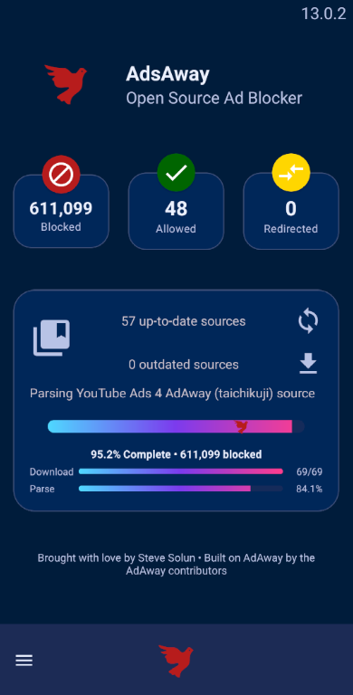
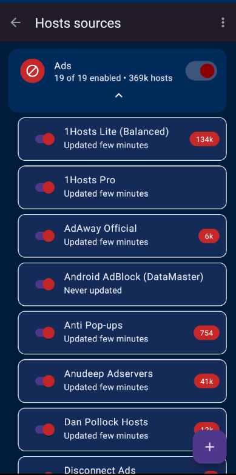
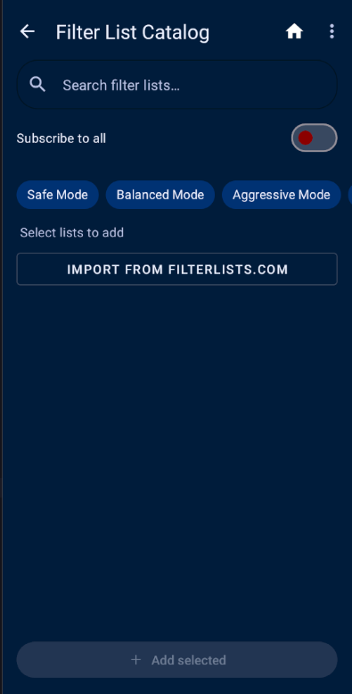

#  AdAway

**AdAway** is an open-source domain blocker for Android. Without root, it uses a local VPN to filter DNS requests that reach it. It can block listed advertising and tracking domains, but not ads served from the same domain as a page or traffic that bypasses its DNS.

AdAway ships with a modernized Material 3 UI, deep FilterLists.com integration,
categorized filter management, and one-tap onboarding.

[](https://github.com/stevesolun/AdAway/releases)
[](/LICENSE.md)

---

## Table of Contents

1. [What's New](#whats-new)
2. [Features](#features)
3. [Screenshots](#screenshots)
4. [Installing](#installing)
5. [Architecture](#architecture)
6. [Filter Categories](#filter-categories)
7. [Building from Source](#building-from-source)
8. [How-To Guides](#how-to-guides)
9. [Permissions](#permissions)
10. [Troubleshooting](#troubleshooting)
11. [Contributing](#contributing)
12. [License](#license)

---

## What's New

See the [changelog](CHANGELOG.md) for current beta changes, upgrade notes, and
validation limits.

---

## Features

### Blocking Modes

| Mode | How it works | Root needed? |
|------|-------------|:------------:|
| **Root** | Writes to `/etc/hosts` — blocks at kernel level | ✅ Yes |
| **VPN** | Runs a local DNS proxy via Android VPN API | ❌ No |

Both modes block at the DNS level — no content injection, no HTTPS inspection.

### Filter Management

- **12 filter categories** — ADS, YOUTUBE, PRIVACY, MALWARE, CRYPTO, SOCIAL, DEVICE, SERVICE, ANNOYANCES, REGIONAL, USER, CUSTOM
- **Quick-start presets** — Safe / Balanced / Aggressive chip taps on Discover
- **FilterLists.com browser** — 5000+ community lists, search by name, tag, or language
- **Categorized source view** — sources grouped and color-coded by category
- **Custom lists** — compatible DNS-oriented lists with explicit hosts, domains, allowlist, or redirect rules
- **One-tap subscribe / unsubscribe** from FilterLists.com directory
- **Filter Sets** — save named presets, apply with one tap
- **Scheduled updates** — daily or weekly automatic list refresh

### Performance

- Concurrent downloads with bounded parser workers and one database import writer
- Conditional GET skips re-downloading unchanged lists (ETag / Last-Modified)
- Batched database writes and staging for large lists
- Source-specific rules are retained so Domain Checker can identify matching lists
- OkHttp connection pool tuning — larger pool, more parallel connections

### Safety

- WaTg Safety Allowlist — wildcards for `*.whatsapp.com`, `*.whatsapp.net`, `*.fbcdn.net`, `*.facebook.com`, `*.telegram.org`, `*.telegram.me`, `*.t.me` prevent blocking WhatsApp and Telegram
- SOCIAL / DEVICE categories flagged as "may break services" — shown with warnings in UI
- Download errors persisted per-source — visible in the source card without re-downloading

---

## Screenshots

| **Home** | **Discover** | **More** |
|:---:|:---:|:---:|
|  |  |  |
| Status, stats, one-tap toggle | Browse & subscribe FilterLists.com | Tools, settings, about |

---

## Installing

### Download APK (Quickest)

1. Go to [**Releases**](https://github.com/stevesolun/AdAway/releases) and select
   the release or beta you intend to install.
2. Download its `AdAway_<version>.apk` asset and read its upgrade notes.
3. **Already using this fork?** Install the APK over your existing app if the signing key matches. Do not uninstall a working copy just to update it.
4. **Switching from upstream or a differently signed build?** Android cannot install this APK over it. Before uninstalling, export the rules and sources you want to keep to a file outside the app. Uninstalling removes app data. The JSON backup does not include preferences.
5. Open the APK on your device and allow "Install unknown apps" for the installer if prompted. For a new installation, choose VPN and approve Android's consent prompt. Use **More → Backup & Restore** to restore a compatible backup, then update the sources.

### Requirements

- Android 8.0 (API 26) or later
- Root mode: rooted device with `su` binary
- VPN mode: no root needed

> **Note**: CI debug artifacts are signed with a debug key. Tagged GitHub
> releases must be production-signed and pass APK hash, package, version, and
> signing-certificate verification before upload. Android prevents updating over
> the official AdAway when signing keys differ. Follow the backup steps above before switching.

For this fork's prior beta signing compatibility, follow the
[changelog's upgrade notes](CHANGELOG.md). The in-app updater reports download,
verification, and installer progress separately; opening the installer does not
confirm installation. Use **Retry update** after a failed or canceled download or
installation attempt, or **Check again** when a check fails or update authorization
has expired.

---

## Architecture

### Module Structure

```
AdAway/
|-- app/                    # Android application
|-- sentrystub/             # Sentry stub for release builds
`-- tcpdump/                # Source-only native packet-capture history; not packaged
```

Current Gradle builds include `:app` and `:sentrystub`; tcpdump is source-only for APK
purposes, and the historical local webserver is absent from the current build. The runtime
critical path is the Android app database, parser, root hosts writer, and VPN DNS proxy.

### App Source Layout

```
app/src/main/java/org/adaway/
├── broadcast/
│   ├── BootReceiver.java          # Restart protection on reboot
│   ├── UpdateReceiver.java        # Trigger source updates externally
│   └── Command.java               # Broadcast command enum
├── db/
│   ├── dao/                       # HostsSourceDao, HostListItemDao, HostEntryDao
│   ├── entity/                    # Persisted source and rule entities
│   └── AppDatabase.java           # Room database and registered migrations
├── model/
│   ├── source/
│   │   ├── SourceModel.java           # Download → Parse → Insert pipeline
│   │   ├── SourceLoader.java          # Parser (hosts/domains/adblock formats)
│   │   ├── FilterListCatalog.java     # Curated lists and preset membership
│   │   └── FilterListCategory.java    # Category enum (ADS/PRIVACY/MALWARE/…)
│   ├── adblocking/                # Root/VPN switching logic
│   ├── backup/                    # Backup/restore (JSON format)
│   ├── git/                       # GitHub/GitLab/Gist source types
│   └── update/                    # APK self-update check
├── ui/
│   ├── home/                      # HomeActivity (nav shell) + HomeFragment + ViewModel
│   ├── discover/                  # FilterLists.com browser + catalog presets
│   ├── more/                      # Tools & settings navigation
│   ├── onboarding/                # First-run single-screen wizard
│   ├── lists/                     # Custom blocked/allowed/redirected rules
│   ├── hosts/                     # Filter sources, FilterSetStore presets + scheduling
│   ├── prefs/                     # Preferences screens
│   ├── adware/                    # Installed app adware scanner
│   ├── log/                       # Real-time DNS query log
│   └── domainchecker/             # Manual domain lookup tool
├── util/
│   └── AppExecutors.java          # diskIO / networkIO / mainThread pools
└── vpn/                           # Local VPN + DNS proxy (non-root mode)
    ├── dns/                       # DnsPacketProxy, DnsQuery, DnsQueryQueue
    └── worker/                    # VpnWorker, watchdog, throttler
```

### Threading Model

```
diskIO()     → Single-threaded executor — Room DB reads/writes
networkIO()  → Fixed-size pool — OkHttp HTTP calls (NEVER mix with diskIO)
mainThread() → Android main looper — UI updates only
WorkManager  → Long-running background jobs (subscribe-all, scheduled updates)
```

**Rule**: Network on `networkIO()`. DB on `diskIO()`. UI on `mainThread()`. Never cross streams.

### Database Schema

[`AppDatabase`](app/src/main/java/org/adaway/db/AppDatabase.java) declares the
current Room version, entities, and registered migration chain. The generated
[Room schema exports](app/schemas/org.adaway.db.AppDatabase) own the table and
column definitions. Source-update generation and conditional HTTP handling live
in [`SourceModel`](app/src/main/java/org/adaway/model/source/SourceModel.java).

## Filter Categories

| Category | Description |
|----------|-------------|
| **ADS** | Advertisement domains |
| **MALWARE** | Malware, phishing, ransomware domains |
| **YOUTUBE** | YouTube-related domains; does not guarantee removal of in-stream ads |
| **PRIVACY** | Tracking and analytics domains |
| **CRYPTO** | Browser-based cryptocurrency mining domains |
| **ANNOYANCES** | Annoyance-related domains; does not hide cookie banners or overlays |
| **REGIONAL** | Region-specific ad networks |
| **SERVICE** | In-app ad domains (Spotify, etc.) — may break those apps |
| **SOCIAL** | Social media trackers — **may break Facebook/Instagram/WhatsApp** |
| **DEVICE** | OEM telemetry (Samsung/Xiaomi) — **may break OEM features** |
| **USER** | Your personal blocked/allowed/redirected rules |
| **CUSTOM** | Custom sources added via URL |

Categories describe list topics, not a guarantee of compatibility or safety.
See the [filter rule capability matrix](docs/filter-rule-capabilities.md) for
supported DNS rules and the limits of browser filter lists.

### Quick-Start Presets

**Safe**, **Balanced**, and **Aggressive** add or re-enable curated lists without
clearing your other subscriptions. They select individual lists, not entire
categories. Default feeds and exact preset membership are defined in
[`FilterListCatalog`](app/src/main/java/org/adaway/model/source/FilterListCatalog.java).

---

## Building from Source

### Prerequisites

| Tool | Required Version |
|------|-----------------|
| Android Studio | Hedgehog (2023.1) or later |
| Android SDK | API 36 |
| Android Build Tools | 36.0.0 |
| Android NDK | **27.2.12479018** (exact - C native code) |
| JDK | 21 |
| Git | Any recent version |

### Clone and Build

```bash
git clone https://github.com/stevesolun/AdAway.git
cd AdAway

# Debug build (for development + testing)
./gradlew assembleDebug

# Direct-download release build
./gradlew :app:assembleDirectRelease --dependency-verification=strict

# Run unit tests
./gradlew testDebugUnitTest

# Install directly to connected device or emulator
./gradlew installDebug
```

**Output APKs:**
- Debug: `app/build/outputs/apk/debug/app-debug.apk`
- Direct release: `app/build/outputs/apk/directRelease/app-directRelease.apk`

### UX Matrix Review Packet

For pre-release UI review, select a disposable emulator and explicitly authorize
capture. The runner reinstalls test packages and erases AdAway app data on that
emulator; physical devices are refused. Replace the example serial with your
emulator's serial. Existing font and locale settings are restored afterward.

```powershell
powershell -NoProfile -ExecutionPolicy Bypass -File .\scripts\run-ux-matrix.ps1 `
  -DeviceSerial emulator-5554 -AllowDestructiveCapture `
  -OutputDir app\build\reports\ux-matrix
```

The runner covers English at baseline and 1.3/1.6 font scales, plus Hebrew RTL at 1.3/1.6.
It checks the rendered locale, layout direction and font scale on each screen in VPN mode.
It pulls screenshots for the key app shells and writes
`app/build/reports/ux-matrix/ux-matrix-review.md`, a checklist packet for manual
review of clipping, overlap, touch targets, RTL anchoring, FAB clearance, and the
AdAway bird brand signal. The packet includes `Source commit`, binding the
screenshots and checklist to the source revision that generated them.

After the reviewer marks every checklist item in `ux-matrix-review.md` as
complete, verify the sign-off packet and write a durable report:

```powershell
powershell -NoProfile -ExecutionPolicy Bypass -File .\scripts\verify-ux-signoff.ps1 `
  -ReviewPacket app\build\reports\ux-matrix\ux-matrix-review.md `
  -Reviewer "<name>" `
  -ReportPath app\build\reports\ux-matrix\ux-signoff-report.md
```

For CI-backed UX sign-off, run the manual
`.github/workflows/verify-ux-signoff.yml` workflow with `review_packet_base64`,
the base64-encoded checked `ux-matrix-review.md`, and the reviewer identity.
Successful runs upload a `ux-signoff-report` artifact with the current source
commit and the checked packet's source commit; stale packets from another
source revision are rejected.

For release smoke, first download all six published assets into one directory:
`AdAway_<version>.apk`, its `.sha256`, `manifest.json`, its `.sha256`,
`adaway.cdx.json`, and its `.sha256`. Use JDK 21, PowerShell, GitHub CLI with
read access, and Android build-tools 36.0.0 via `ANDROID_HOME` or
`ANDROID_SDK_ROOT`. Supply the trusted manifest public key and release certificate
pin independently of the downloaded metadata. See `RELEASING.md` for download commands.

```powershell
$Version = "<version>"
$Tag = "v$Version"
$Apk = "release-artifacts\AdAway_$Version.apk"
.\scripts\run-release-smoke.ps1 `
  -ApkPath $Apk -ReleaseTag $Tag `
  -ExpectedCertSha256 "<trusted-release-certificate-sha256>" `
  -PublicKeyBase64 "$env:UPDATE_MANIFEST_PUBLIC_KEY_BASE64" `
  -VerifyOnly -ReportPath release-smoke\identity-only-report.md
# On the intended physical device; this installs/updates the app and launches it:
.\scripts\run-release-smoke.ps1 `
  -ApkPath $Apk -ReleaseTag $Tag `
  -ExpectedCertSha256 "<trusted-release-certificate-sha256>" `
  -PublicKeyBase64 "$env:UPDATE_MANIFEST_PUBLIC_KEY_BASE64" `
  -DeviceSerial "<physical-device-serial>" `
  -ReportPath release-smoke\release-smoke-report.md
```

Both modes verify actual APK identity, authenticated metadata and all six
attestations before device access; `-VerifyOnly` is not an offline or metadata-only
bypass and does not satisfy the physical smoke gate. For renewed metadata, add
both `-MetadataSourceCommit "<40-hex-refresh-workflow-commit>"` and
`-MetadataSourceRef "refs/heads/<refresh-branch>"` to each command, using the exact
refresh run identity. Unknown or mismatched provenance fails closed.

After release artifact verification, physical release smoke, UX sign-off, and
license-boundary checks have all produced reports, aggregate them into one final
readiness report:

```powershell
powershell -NoProfile -ExecutionPolicy Bypass -File .\scripts\verify-release-readiness.ps1 `
  -ReleaseArtifactReport release-artifacts\verification-report.md `
  -PhysicalSmokeReport release-smoke\release-smoke-report.md `
  -UxSignOffReport app\build\reports\ux-matrix\ux-signoff-report.md `
  -UxReviewPacket app\build\reports\ux-matrix\ux-matrix-review.md `
  -LicenseBoundaryReport app\build\reports\license-boundary\license-boundary-report.md `
  -ReportPath release-readiness-report.md
```

The readiness verifier requires all proof reports to describe the same source commit
as the artifact: artifact/smoke `Artifact source commit` must match UX/license
`Source commit`. Each report's separate `Tooling source commit` may differ from
the APK commit and from the other verifier's checkout.
It also requires the artifact verifier and physical smoke report to
describe the same release tag, APK name, APK SHA-256, and signing certificate
digest; do not combine proof reports from different release attempts. The
release artifact report must come from `verify-release-artifacts` and include
`Artifact source commit`, `Artifact source ref`, `Artifact source workflow`,
`Artifact provenance: verified`, `Tooling source commit`, `APK identity: verified`,
`Checksum verification: passed`, `Manifest signature: passed`,
`Manifest payload: passed`, and a checked `Expected certificate SHA-256`.
The physical smoke report must come from `run-release-smoke.ps1` in
physical-device mode and include `Release tag`, `Package`,
`Signer certificate check: True`, `Signer certificate SHA-256`,
`Device serial SHA-256`, `Launch pid observed`, and the same explicit artifact
provenance and APK identity fields. Old `Source commit`-only artifact/smoke reports
are rejected. Metadata refresh provenance is recorded separately from APK provenance.
Use the tagged release artifact license-boundary report for
`-LicenseBoundaryReport`; it must show `Strict artifacts: true` with the same APK and SBOM
artifact names from the release artifact verification report, not the regular CI source-only
license-boundary report.
The UX sign-off report must come from `verify-ux-signoff.ps1` and include a
reviewer, review packet, `Source commit`, `Review packet source commit`,
`Review packet SHA-256`, checked item count, `Unchecked items: 0`, and
`Issues: 0`; do not use hand-written pass markers.
When `-UxReviewPacket` is provided, final readiness also hashes the checked
review packet and requires the same review packet hash as the sign-off report.
The generated `release-readiness-report.md` repeats the release tag, APK, APK
SHA-256, SBOM, artifact source commit, and UX review packet hash, then records
`Release artifact report SHA-256`, `Physical smoke report SHA-256`,
`UX sign-off report SHA-256`, and `License boundary report SHA-256` so the final
summary is tied to the exact proof reports it consumed.

For CI-backed final aggregation, run the manual
`.github/workflows/verify-release-readiness.yml` workflow after the post-publish
artifact verifier, physical release smoke, UX sign-off, and release
license-boundary reports exist. Provide the run IDs for
`release-artifact-verification-report`, `physical-release-smoke-report`, and
`release-license-boundary-reports`, plus `ux_signoff_run_id`, the run that
uploaded the generated `ux-signoff-report` and checked `ux-matrix-review.md`.
Successful runs upload a `release-readiness-report` artifact.

### Production Signing

Add to `~/.gradle/gradle.properties`:

```properties
signingStoreLocation=/path/to/keystore.jks
signingStorePassword=your_store_password
signingKeyAlias=your_key_alias
signingKeyPassword=your_key_password
updateManifestPublicKeyBase64=base64_encoded_spki_public_key
releaseSigningCertificateSha256=trusted_release_certificate_sha256
```

### CI/CD — Automatic Releases

Push a signed version tag to trigger the release pipeline:

```bash
git tag -s v<version> -m "AdAway <version>"
git verify-tag v<version>
git push origin v<version>
```

GitHub Actions (`.github/workflows/fork-release-apk.yml`) will:
1. Verify the signed release tag with `RELEASE_TAG_PUBLIC_KEY_BASE64`
2. Build `assembleDirectRelease`
3. Rename the APK to `AdAway_<version>.apk`
4. Verify the APK package name, tag-matching version, signer SHA-256, and file SHA-256
5. Generate the signed update manifest
6. Generate the CycloneDX SBOM and SHA-256 checksum files
7. Attest the APK, manifest, SBOM, and their `.sha256` checksum sidecars
8. Verify those GitHub attestations with the canonical artifact verifier
9. Create a GitHub Release with the APK, manifest, checksums, and SBOM attached

Before announcing a release, run the `RELEASING.md` artifact verifier and
release smoke. Full smoke requires an attached physical device. After the
release is created, run the manual `verify-release-artifacts.yml` workflow as
the CI-backed post-publish artifact and attestation check; successful runs
upload a `release-artifact-verification-report` artifact. For install/launch
coverage, run `physical-release-smoke.yml` on a self-hosted runner labeled
`android-device`; it downloads all six tagged assets and runs the full release smoke
against a physical device. Successful physical smoke runs upload a
`physical-release-smoke-report` artifact with release tag, APK name, APK
SHA-256, signer certificate identity, and the observed launch result. Regular
CI also uploads a `license-boundary-report`; tagged direct-APK releases upload
`release-license-boundary-reports` covering source and packaged artifact
GPL/MIT boundary checks.
Run `verify-release-readiness.yml` last to download those proof artifacts,
download the generated UX sign-off report, run `verify-release-readiness.ps1`,
verify the same review packet hash, and upload the final
`release-readiness-report` artifact.

**Repository Secrets** (for production-signed APKs):

| Secret | Description |
|--------|-------------|
| `ANDROID_KEYSTORE_BASE64` | Base64-encoded keystore file |
| `ANDROID_KEYSTORE_PASSWORD` | Keystore password |
| `ANDROID_KEY_ALIAS` | Key alias |
| `ANDROID_KEY_PASSWORD` | Key password |
| `UPDATE_MANIFEST_PUBLIC_KEY_BASE64` | Base64 SPKI public key embedded for signed update-manifest verification |
| `UPDATE_MANIFEST_PRIVATE_KEY_BASE64` | Base64 PEM private key used to sign update manifests |
| `ANDROID_RELEASE_CERT_SHA256` | Expected release APK signing certificate SHA-256 digest |
| `RELEASE_TAG_PUBLIC_KEY_BASE64` | Base64 public key imported before `git verify-tag` |

Regular CI and CodeQL build debug artifacts. Production release builds are
expected to fail closed without the signing properties, signed-tag key, and
update-manifest trust material above.

### Key Dependencies

| Library | Version | Purpose |
|---------|---------|---------|
| OkHttp | 5.4.0 | HTTP downloads and update checks |
| Timber | 5.0.1 | Logging (no-op in release) |
| libsu | 6.0.0 | Root shell access |
| pcap4j | 1.8.2 | VPN packet capture/processing |
| dnsjava | 3.6.5 | DNS packet parsing |
| Guava | 33.6.0-android | Utilities |

## How-To Guides

### Set Up Protection (First Time)

1. Open the app — the onboarding screen appears.
2. Auto-detection checks root availability. If root is unavailable, VPN mode is pre-selected; rooted devices can choose Root mode or VPN mode.
3. Tap **Start protecting** and approve Android's VPN consent dialog if requested.
4. On Home, enabled filters that have never downloaded start downloading automatically,
   including the seeded defaults. Existing custom lists and disabled selections are preserved.
5. Wait for the download and apply to finish before relying on filter protection.
   If setup fails, use **Update** on Home to try again; reopening the app does not retry setup.

### Add a Filter List from FilterLists.com

1. Tap the **Discover** tab.
2. Use the search box or filter by tag / language.
3. Tap a list → **Subscribe**.
4. The list is added and enabled; downloading and applying starts automatically.
   See [Source Update Feedback](#source-update-feedback).

For a batch, check the rows you want, then use **Subscribe selected** or
**Unsubscribe selected**. **Show subscribed** narrows the view to existing
subscriptions. Selecting a row is not itself a subscription. A browser-only
list may have no DNS-compatible rules; choosing it cannot make those rules
work at the domain level.

### Apply a Quick-Start Preset

1. Tap the **Discover** tab.
2. Tap **Safe**, **Balanced**, or **Aggressive**.
3. A snackbar reports added lists, existing lists needing an update, or that the
   preset is already subscribed.
4. Added or re-enabled lists update automatically, as do selected lists with a
   known newer revision, no downloaded rules, or a previous download error.
   See [Source Update Feedback](#source-update-feedback).

### Add a Custom Filter List

1. Open the **Sources** tab.
2. Tap **+**, then **Add custom source**.
3. Enter the public HTTPS URL of a DNS-compatible filter; the name is optional.
4. Save with the toolbar checkmark. The enabled source downloads and applies automatically.
   See [Source Update Feedback](#source-update-feedback).

The region or publisher does not matter. Hosts files and domain lists are
supported; a DNS filter cannot apply browser-only cosmetic rules. To use a
local list, choose **File** in the editor and select it with Android's picker.
Remote refreshes require a direct public HTTPS route. AdAway does not fetch
private network addresses or silently bypass a required system proxy.

### Source Update Feedback

A successful automatic import or **Update all** clears the Sources **Apply** prompt
for the configuration it applied. Download metadata alone does not bring the prompt
back. Later selection or URL changes can still need **Apply**; updating one source
does not acknowledge pending changes to other sources. If a Sources update/apply
fails, its failure message keeps an **Apply** action that retries the same operation.
When another update already owns the operation, Sources reports that it is busy
instead of reporting a download failure.

When Home reports a failed source download, tap **Sources** to inspect each source's
error, correct or disable the failing source, then apply again. A source failure does
not necessarily mean the device is offline. See the [changelog](CHANGELOG.md) for
retired-feed upgrade notes. Local file sources can be checked and refreshed offline.

Home counts enabled external sources that have never downloaded as **outdated**.
A successfully downloaded empty list can be up to date; disabled sources and custom
user rules are excluded from both freshness totals.

### Block / Allow a Specific Domain

1. Go to **More → Custom Rules**.
2. Tap **+** → choose **Block** or **Allow** → enter the domain.
3. Tap **Save**. Rules apply immediately (no update needed).

### Batch Import Domains

1. **More → Custom Rules → ⋮ → Batch Import**.
2. Paste domains, one per line.
3. Choose Block or Allow → confirm.

### View DNS Query Log (VPN mode only)

1. Go to **More → DNS Log**.
2. See real-time queries. Blocked = red, allowed = green.
3. Tap any entry → **Block** or **Allow** to add a custom rule.

### Schedule Automatic Updates

1. **More → Filter Sources → ⋮ → Manage schedules**.
2. Set daily (time) or weekly (day + time).
3. Updates run in the background at the scheduled time.

### Check If a Domain Is Blocked

**Domain Checker (no API key needed):**

1. **More → Domain Checker**.
2. Type any domain (or URL — port is stripped automatically).
3. Tap **Check** to see **Blocked**, **Redirected**, **Allowed**, or **Unknown** for
   the active blocking mode. Blocked and redirected results list matching sources;
   allowed results show the matching allow rules and their sources. **Unknown**
   means no active rule determines the result.

**Remove Allow Rule** is offered only for your exact allow rule on the checked
domain. It preserves downloaded rules and broader wildcard or suffix allows, so
the domain can remain allowed after removal. **Block it** is offered for Unknown
results, not for domains already allowed by a filter.

### Backup & Restore

1. **More → Backup & Restore**.
2. **Backup** — exports filter sources and custom rules as JSON; app preferences
   are not included.
3. **Restore** — imports from a backup file. If another operation is in progress,
   wait for it to finish, then select **Restore** again.

Restoring a source with the same URL updates its configuration while retaining its
identity. Download newly restored sources or sources whose rule format changed, then
apply. File-source read permission must be granted again when it is no longer available.

### Force English Locale

Some Android versions override language settings. To lock AdAway in English:
1. **More → Preferences → General → Force English**.
2. The app switches its interface to English. Turn the setting off to follow the system language again.

---

## FilterLists.com API

The Discover tab integrates the FilterLists.com public API:

| Endpoint | Used for |
|----------|----------|
| `GET /lists` | Browse all filter lists (with tagIds, languageIds, syntax) |
| `GET /tags` | Tag chip labels (41 tags, cached 24h in SharedPreferences) |
| `GET /languages` | Language spinner (81 languages, cached 24h) |
| `GET /lists/{id}` | Subscription URL for a specific list |

Responses are cached with a 24-hour TTL. No API key required.

---

## Permissions

| Permission | Purpose |
|------------|---------|
| `INTERNET` | Download filter lists, query FilterLists.com, and check updates |
| `RECEIVE_BOOT_COMPLETED` | Restart VPN / hosts protection on device reboot |
| `FOREGROUND_SERVICE` | Background subscribe-all worker notification |
| `POST_NOTIFICATIONS` | Update completion notifications (Android 13+) |
| Launcher package visibility query | Adware scanner — list launchable installed apps |
| `BIND_VPN_SERVICE` | Local VPN mode (non-root) |

Root mode additionally requires `su` access to write `/etc/hosts`.

---

## Troubleshooting

| Symptom | Fix |
|---------|-----|
| Ads not blocked | Tap **Update** on Home to refresh filter lists |
| VPN disconnects randomly | Check **More → Preferences → VPN** settings |
| WhatsApp stops working | Keep the built-in WaTg safety allowlist enabled; if a custom source still breaks messaging, use **Domain Checker** or **DNS Log** to add a targeted allow rule |
| Samsung Pay / OEM feature broken | Disable the **DEVICE** category |
| Filter list not updating | Follow [Source Update Feedback](#source-update-feedback) to inspect and retry the failed source |
| App crashes on subscribe | Reopen the app and retry; report repeated failures through [this fork's issues](https://github.com/stevesolun/AdAway/issues) |
| Can't install over official AdAway | Different signing key. Follow the [backup and installation steps](#download-apk-quickest) before removing anything. |
| "Install unknown apps" blocked | Android Settings → Apps → Special app access → Install unknown apps |
| Domain Checker result is unexpected | See [Check If a Domain Is Blocked](#check-if-a-domain-is-blocked) for result meanings and allow-rule controls |
| Some text stays in English | Turning off **Force English** follows your system language; strings without a translation still use English. |

---

## Contributing

- Bug reports: [this fork's issues](https://github.com/stevesolun/AdAway/issues)
- PRs welcome — keep commits atomic, present tense, explain *why* not *what*

See [CONTRIBUTING.md](CONTRIBUTING.md#style-guidelines) for code style and
[`app/build.gradle`](app/build.gradle) for Java compatibility settings.

**Threading rules (mandatory):**
- DB operations: `AppExecutors.getInstance().diskIO()`
- HTTP calls: `AppExecutors.getInstance().networkIO()`
- UI: `AppExecutors.getInstance().mainThread()`
- Never call `AppExecutors.getInstance()` in a `static final` field initializer

**DB migrations:** Preserve existing user data when changing the
[database schema](#database-schema). Add the migration in
[`Migrations`](app/src/main/java/org/adaway/db/Migrations.java), register it in
`AppDatabase`, and cover it with
[`MigrationTest`](app/src/androidTest/java/org/adaway/db/MigrationTest.java).

---

## License

MIT relicensing is tracked as a future option only. The distributed app remains GPLv3+
until GPL-derived app/VPN code, assets, and third-party notice boundaries are cleared and
verified; see [docs/mit-relicensing-plan.md](docs/mit-relicensing-plan.md).

[GPL v3](/LICENSE.md) — same as the upstream AdAway project.

---

## Upstream & Credits

This is a fork of [AdAway/AdAway](https://github.com/AdAway/AdAway). All credit to the original AdAway team and contributors.

Crafted with love by Steve Solun · Forked from AdAway
